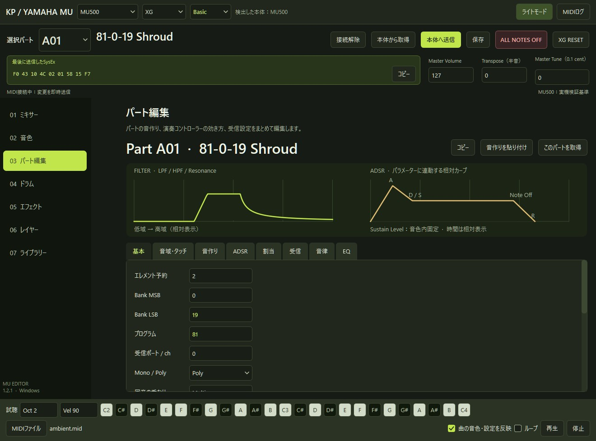

# KP YAMAHA MU Editor

[English](README_EN.md)

## 概要
 YAMAHA MUシリーズの設定を、Windows 11から編集・保存するスタンドアロンMIDIエディター・コントローラです。SC-88Proのエディターソフト「Mix88」のMU版が欲しいという思想の元作成されました。

 Basic/Native切り替え、インサーションエフェクト、MultiEQなどのSysEx周りや、SMF format1書き出し、SysExのコピーなど、DAWとの連携、MIDIシーケンサー連携で必要になりそうなことは一通りやれるようにしています。

## 対象機種
| 機種 | 確認範囲 |
| --- | --- |
| MU500 | 実機確認済み |
| MU5、MU5K、MU10、MU15、MU50、MU80、MU90、MU90B、MU90R、MU100、MU100B、MU100Bs、MU100R、MU128、MU128 V2 | 仕様書ベース・実機未確認 |
| MU1000、MU2000、各EX／EX R1 | 仕様書ベース・実機、EFX3/4、バリエーションエフェクト27種、インサーションエフェクト54種未確認  |

- Modular Synthesis Plug-in System（PLG）のパート割当はVL／SG／DX種別の試験機能です。
- プラグインシステムボードの実機動作と内部音色編集、MU2000のサンプル編集・波形転送は対応範囲外です。
- 入手性、需要の観点からMU1000/2000の確認予定はありません。

## 起動と接続

1. GitHubの **Releases** から Windows 11用ZIPを取得し、フォルダーごと展開します。
2. `KP_YAMAHA_MUeditor.exe` を起動し、上部で機種を選びます。
3. **接続** でMUのMIDI入出力を選び、設定の取得が完了するまで待ちます。

接続中の編集は本体に即時送信されます。現在の設定を残すには、編集前に **本体から取得** して保存してください。

## 主な機能

- パートの音色、音量、パン、フィルター、EG、エフェクトを編集
- 音色ブラウザーで名前や `Program-MSB-LSB` を検索
- ドラムのノート別設定、レイヤー、試聴鍵盤、SMF再生
- 本体設定の取得・復元、MUセット・SysEx・SMF Format 1の保存
- 日本語／英語とライト／ダークの切替

## ドキュメント

- [接続・基本操作・トラブル時の確認](docs/usage-ja.md)
- [対応機種と実機確認の範囲](docs/compatibility.md)
- [ソースからの起動とビルド](docs/build.md)
- [保存データの取り扱い](docs/security.md)

[GPL-3.0-or-later](LICENSE)で配布します。著作者は干瓢碁です。[第三者ライセンス](docs/third-party-notices-ja.md)

## 開発

干瓢碁がアーキテクチャ設計、MU500での実機テスト、検証結果をもとにした修正指示を担当し、コードの実装にはOpenAI Codexを使用しました。
