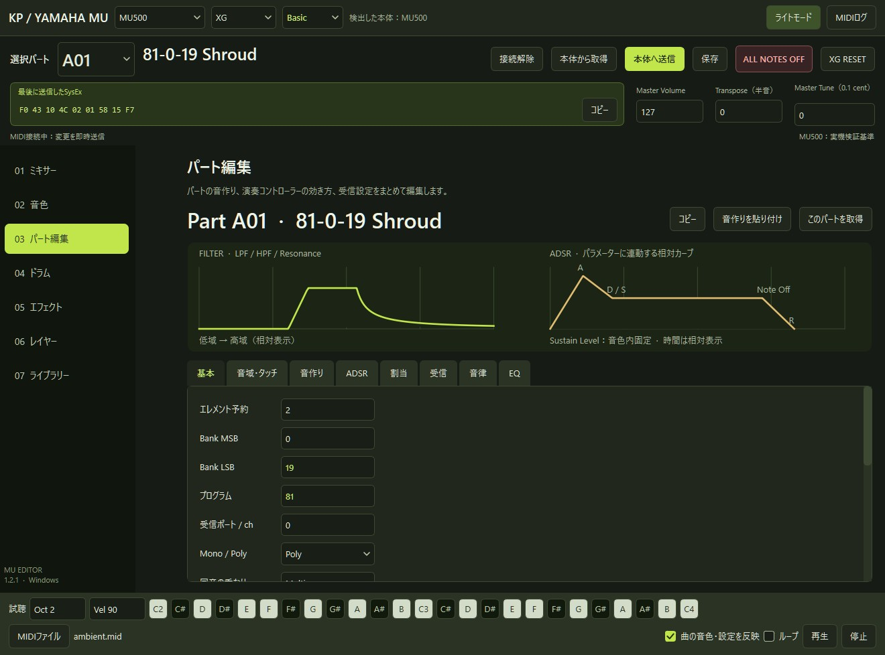

# KP YAMAHA MU Editor

[日本語](README.md)

## Overview

A standalone MIDI editor and controller for editing and saving Yamaha MU-series settings on Windows 11. It started with the idea of making an MU equivalent of Mix88, the SC-88Pro editor.

For use with a DAW or MIDI sequencer, it supports Basic and Native modes, SysEx editing for insertion effects and Multi EQ, SMF Format 1 export, and copying SysEx messages.

## Supported models

| Models | Verification |
| --- | --- |
| MU500 | Tested on hardware |
| MU5, MU5K, MU10, MU15, MU50, MU80, MU90, MU90B, MU90R, MU100, MU100B, MU100Bs, MU100R, MU128, MU128 V2 | Based on the MIDI documentation. Untested on hardware. |
| MU1000, MU2000, and their EX and EX R1 variants | Based on the MIDI documentation. Hardware operation, EFX 3/4, 27 variation effects, and 54 insertion effects are unverified. |

- Modular Synthesis Plug-in System (PLG) part assignment is experimental for VL, SG, and DX board types.
- Plug-in board operation on hardware, editing the boards' internal voices, MU2000 sample editing, and waveform transfer are outside the scope of this editor.
- There are no plans to test the MU1000 or MU2000 because of limited availability and demand.

## Getting started

1. Download the Windows 11 ZIP from GitHub **Releases** and extract the entire folder.
2. Start `KP_YAMAHA_MUeditor.exe` and select your MU model at the top of the window.
3. Click **Connect**, select the MU MIDI input and outputs, and wait for the device read to finish.

Edits are sent to the device immediately while connected. To keep a copy of your current settings, use **Read from device** and save the set before editing.

## Features

- Edit part voices, volume, pan, filters, envelopes, and effects
- Find voices by name or `Program-MSB-LSB` in the voice browser
- Edit drums per note, create layers, audition sounds on the keyboard, and play SMF files
- Read and restore device settings and save MU sets, SysEx, or SMF Format 1 files
- Switch between Japanese and English and between light and dark themes

## Documentation

- [Connection, basic controls, and troubleshooting](docs/usage-en.md)
- [Model compatibility and hardware testing](docs/compatibility-en.md)
- [Run and build from source](docs/build-en.md)
- [Stored data and sharing](docs/security-en.md)

Released under [GPL-3.0-or-later](LICENSE) by 干瓢碁. [Third-party notices](THIRD_PARTY_NOTICES.md)

## Development

Kanpyog (干瓢碁) designed the architecture, tested the editor on an MU500, and directed revisions based on that feedback. The code was implemented using OpenAI Codex.
